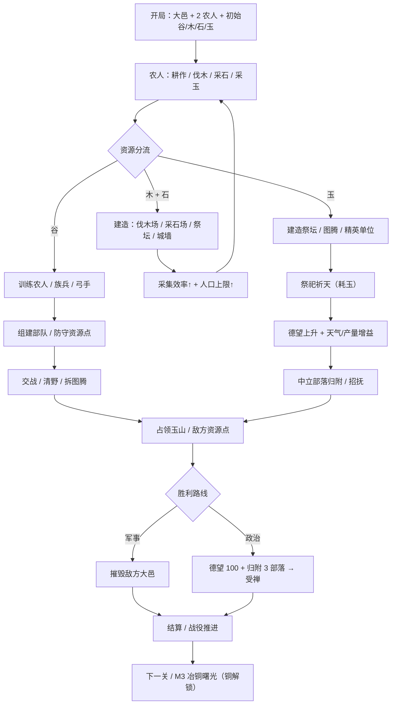

# RTS小游戏·三皇五帝 设计方案 v2

> 状态：**方案待确认，本轮不改代码**
> 前作：[DESIGN.md](DESIGN.md)（v0.1，通用采矿 RTS 骨架）
> 素材依据：[ERA_RESEARCH.md](ERA_RESEARCH.md)（含证据分级 A/B/C/D）
> 技术底座不变：Vite + TypeScript + Phaser 3，正交俯视 2D，纯前端单页。

---

## 0. 一句话定位

**把 RTS 的「采矿—造兵—推基地」换成「耕作—祭祀—争德望」，让玩家在涿鹿的风雨与大雾里，用图腾、天气和人心而不是魔法打赢一场上古战争。**

---

## 1. 题材定位与差异化卖点

### 1.1 为什么值得做

1. **认知度极高，但游戏化几乎空白。** 炎黄、蚩尤、涿鹿、大禹治水是全民级文化符号；市面上有三国、西游、封神，但「三皇五帝」很少有 RTS 认真做过。
2. **天然适合 RTS。** 阪泉、涿鹿是部落联盟战争；治水是公共工程；禅让是政治胜利。战争、经济、外交三条线在原典里都有。
3. **视觉成本可控。** 彩陶纹、玉器、图腾剪影都是高辨识度的平面符号，比写实考据便宜得多，正好适配 2D 几何/矢量路线。
4. **与「西方奇幻 RTS」形成清晰反差。** 没有精灵、矮人、魔法阵；有的是旱涝、瘟疫、粮仓、盟誓和人心向背。

### 1.2 与西方奇幻 RTS 的体验差异

| 维度 | 西方奇幻 RTS（魔兽/神话时代） | 本作（三皇五帝） |
| --- | --- | --- |
| 力量来源 | 魔法、神力、英雄技能 | **祭祀、德望、图腾、天气** |
| 资源 | 金/木/食物 + 魔法值 | **谷、木、石、玉 + 德望**（德望不可采集；铜于 M3 解锁） |
| 扩张方式 | 造基地、占矿点 | 占资源点 + **中立部落归附** |
| 胜利方式 | 灭掉对方 | 灭国 **或** 德望受禅（双轨） |
| 单位气质 | 英雄个人主义 | 氏族集体、阵型、士气 |
| 神话单位 | 大量怪兽 | **极少量天象级存在**（应龙/女魃/夔牛），有代价 |
| 视觉 | 高饱和奇幻材质 | 彩陶/玉/黑陶/夯土的符号化平面 |

### 1.3 三条设计支柱

1. **天时**：祭祀与天气改变战场，但不是无条件魔法，要花玉、要读条、会被打断。
2. **地利**：图腾与祭坛是地图上的实体，可争夺、可摧毁，逼玩家离开基地。
3. **人和**：德望让「不打」也是一种打法；滥杀中立部落会反噬。

---

## 2. 阵营划分

推荐 **3 个阵营**，但首发只做 2 个（见第 10 节范围控制）。

| 阵营 | 文化母题 | 图腾 | 主色 | 兵种气质 | 玩法倾向 | 代表古帝 |
| --- | --- | --- | --- | --- | --- | --- |
| **华夏** | 农耕、礼制、联盟、治水 | 龙 / 熊罴 | 土黄 + 玄黑 | 稳健、阵型、工事、耐打 | 中后期强，靠经济与德望滚雪球 | 黄帝、颛顼、帝喾、尧、舜 |
| **东夷** | 日出、鸟官、弓矢、风雨 | 凤鸟 / 玄鸟 | 晨青 + 日白 + 朱砂 | 轻捷、远程、早期压制 | 前期强，靠机动与骚扰拖垮对手 | 太昊、少昊、蚩尤/九黎 |
| **苗蛮** | 玉礼、水稻、巫傩、水网 | 神人兽面 / 虎 | 朱砂 + 玉白 | 坚韧、回复、地形适应 | 防守反击，靠祭祀与持久战 | 三苗、共工（部分说法） |

### 2.1 非对称设计（不靠数值堆）

- **华夏**：`德望` 获取 +20%；祭坛可同时提供「祈谷」；建筑血量高，但单位移速慢。
- **东夷**：射手射程 +15%；开局多 1 只「鸟师」斥候；祭坛可祈「风」，但建筑脆。
- **苗蛮**：单位在浅水/稻田不减速；「巫祝」可回复；玉矿产出 +20%，但人口上限低。

> 设计原则：三个阵营共享 4 个基础骨架（农人、近战、远程、祭司），差异主要来自**图腾光环、祭祀选项、地形适应**，而不是 21 套完全独立的单位。

---

## 3. 资源体系

### 3.1 四种采集资源 + 德望（铜为 M3 解锁）

| 资源 | 获取方式 | 主要用途 | 设计意图 |
| --- | --- | --- | --- |
| **谷** | 农田产出 / 农人耕作 | 训练单位、维持人口 | 主资源，对应「五谷」与定居农业 |
| **木** | 林地，农人砍伐；伐木场提升效率 | 建筑主体、城墙、器械 | 建材，对应木骨泥墙、榫卯、木构聚落 |
| **石** | 石场，农人开采；采石场提升效率 | 建筑基座、城墙、祭坛台基 | 建材，对应石砌基址与夯土城垣 |
| **玉** | 玉山/玉矿，农人开采（玉匠 +50%） | **祭祀的唯一燃料**、图腾升级、精英单位 | 礼器与权力凭证，通往「受禅」的第二胜利路线 |
| **德望** | 不可采集：以祭祀、战胜为主，归附/公共工程为辅 | 招抚中立部落、解锁禅让胜利、稳定士气 | 把「人心」做成可运营的维度 |
| **铜（M3）** | 铜矿，M3 解锁 | 武器/建筑升级 | 「冶铜曙光」科技节点，**不作为开局资源** |

> 定位区别：**木/石只进建筑，不进单位**；**玉只进祭祀、图腾与精英**；**谷负责养人**。三条线各自独立，避免「一种资源包打天下」。

### 3.2 资源体系的设计取舍

**（1）为什么不用「晶石 + 能量」**

- 晶石/能量是科幻 RTS 的语言，与三皇五帝题材没有对应物。
- 谷、木、石、玉在考古上都有实物证据（碳化粟、木骨泥墙、石砌基址、玉琮/玉钺），玩家不需要额外学习成本。
- 德望不是「法力」，不能靠采矿获得，必须通过祭祀与战争行为积累，直接改变最优策略。

**（2）为什么不把铜前置**

- 考据上：**青铜器鼎盛于二里头至商周**（约公元前 1750 年起），而三皇五帝对应的考古背景是**仰韶至龙山**（约距今 7000—4000 年）。龙山晚期只有零星小件铜器，属于**铜石并用**，不是青铜时代。
- 五帝时代的时代标志物是：**彩陶、玉器、夯土城址、木骨泥墙聚落**，不是青铜礼器。
- 设计上：如果开局就有铜，会误导玩家把「青铜」当成时代特征，也会让木/石/玉三线失去意义。
- 结论：铜保留为 **M3 的「冶铜曙光」解锁项**，只用于后期武器/建筑升级，不新增开局采集压力，并在 UI 中明确标注「时代下限，艺术化提前」。

**（3）玉为什么不可替代**

- 玉在史前是**礼器与权力凭证**，不是装饰品：良渚玉琮（通天）、玉钺（军权）、玉璧（祭天）；红山玉猪龙/C 形龙（信仰）。
- 因此玉被设定为**唯一能启动祭祀的资源**：没有玉，就没有祭祀；没有祭祀，就没有稳定的德望；没有德望，就走不通「归附—受禅」路线。
- 玉同时也是精英单位与图腾升级的门槛，但它**不参与建筑主体**——建筑靠木石，玉靠礼制，两者不能互相替代。
- 这样玉就不是「第五种矿」，而是**另一条胜利路线的钥匙**：军事路线烧谷/木/石，政治路线烧玉/德望。

**（4）为什么补木、石**

- 新石器建筑的主材就是木与石：木骨泥墙、木柱、榫卯、夯土版筑、石砌基址。
- 如果建筑只用谷，会出现「用粮食盖城墙」的荒诞感；补入木石后，建造行为才有重量。
- 木/石不设置稀有度门槛，保证玩家不会因为建材卡住而无法建造第一个祭坛。

### 3.3 基础数值（首版）

| 项目 | 数值 |
| --- | --- |
| 开局 | 谷 200、木 120、石 80、玉 20、德望 20、大邑 ×1、农人 ×2 |
| 人口上限 | 基础 12；每座民居 +4；图腾 +4（上限 24） |
| 农人造价 | 50 谷 |
| 族兵 / 夷兵 / 三苗武士 | 60 谷 |
| 弓手 / 夷羿射者 / 掷矛手 | 70 谷 + 10 玉 |
| 精英（虎贲 / 蚩尤勇士 / 傩面卫） | 100 谷 + 25 玉 |
| 祭坛 | 120 谷 + 60 木 + 80 石 + 30 玉 |
| 图腾柱 / 龙旗 / 鸟柱 | 80 谷 + 40 木 + 20 玉 |
| 伐木场 | 80 谷 + 60 木 + 20 石 |
| 采石场 | 80 谷 + 40 木 + 40 石 |
| 祭祀一次 | 20～50 玉（按选项） |
| 德望 | 0～100；归附阈值 50；禅让阈值 100 |

### 3.4 采集规则

- **农田**：农人站进农田范围持续产出，**不来回搬运**（降低操作量，也符合定居农业）。
- **林地**：农人往返搬运，单次 10 木，单程约 3 秒；首版视为可再生，采伐后 60 秒恢复 20 木。
- **石场**：农人往返搬运，单次 8 石，单程约 4 秒；储量 800，采完枯竭。
- **玉山**：农人往返搬运，单次 10 玉，单程约 4 秒；储量 800，采完枯竭。
- **铜矿**：同玉山，储量 500，M3 开放。
- 所有资源点在小地图上有图标，敌方资源点可见（无战争迷雾）。

---

## 4. 单位与建筑清单

> 每个阵营 **7 种单位 + 8 种建筑**，其中 4 种单位共享骨架。总内容量：21 个单位条目、24 个建筑条目，但真正独立的行为约 12 套。
> 建筑分工：**伐木场 / 采石场 / 射庐** 三族通用（换皮不换数值）；主基地、祭坛、图腾、防御工事按阵营替换造型与光环。

### 4.1 华夏（有熊 / 轩辕）

| 单位 | 定位 | 造价 | 取材 | 证据性质 | 机制要点 |
| --- | --- | --- | --- | --- | --- |
| 农人 | 采集/建造 | 50 谷 | 神农教耕、石铲/骨耜 | A + C | 可耕作、伐木、采石、采玉、造建筑 |
| 族兵 | 近战前排 | 60 谷 | 「习用干戈」；石钺 | A + C | 结阵：3 人以上相邻 +10% 防御 |
| 弓手 | 远程 | 70 谷 + 10 玉 | 「弦木为弧，剡木为矢」 | A | 射程 4 格，怕近身 |
| 虎贲 | 精英近战 | 100 谷 + 25 玉 | 「教熊罴貔貅貙虎」 | A（图腾解读） | 血量高，攻击附带恐惧（降低敌方士气） |
| 战车 | 冲阵/攻城 | 140 谷 + 30 玉 | 「轩辕」名号 + 后世战车 | **B 艺术化** | 高速冲锋，撞散阵型；时代错位，标注为演绎 |
| 大巫 | 辅助/祭祀 | 90 谷 + 20 玉 | 颛顼「绝地天通」 | A | 可主持祭祀、驱散天气、治疗 |
| 应龙 | 神话/空军 | 300 谷 + 80 玉 | 《山海经》黄帝令应龙攻蚩尤 | A（神话） | 全场限 1；降雨/蓄水，克制火与旱 |

**建筑（8）**

| 建筑 | 功能 | 造价 | 取材 |
| --- | --- | --- | --- |
| 大邑 | 主基地，训练农人，接收资源 | 200 谷 + 100 木 + 100 石 | 龙山/陶寺夯土城址（C） |
| 粟田 | 谷产出 | 60 谷 + 40 木 | 仰韶粟作农业（C） |
| 伐木场 | 提升范围内林地采集效率 +40%，兼作木料交付点 | 80 谷 + 60 木 + 20 石 | 木骨泥墙聚落、石斧（C） |
| 采石场 | 提升范围内石场采集效率 +40%，兼作石料交付点 | 80 谷 + 40 木 + 40 石 | 石砌基址、石铲石斧（C） |
| 祭坛 | 祭祀、德望、祈谷 | 120 谷 + 60 木 + 80 石 + 30 玉 | 红山圜丘/陶寺观象台（C） |
| 射庐 | 训练族兵/弓手/虎贲 | 100 谷 + 60 木 + 40 石 | 聚落练兵场（C，想象） |
| 龙旗 | 图腾光环：周围单位 +10% 攻击 | 80 谷 + 40 木 + 20 玉 | 红山 C 形龙、二里头绿松石龙（C） |
| 夯土墙 | 防御、阻挡 | 每段 20 谷 + 20 木 + 40 石 | 龙山城垣（C） |

> 采集建筑只提升效率、不改变资源总量：**资源点决定产出，伐木场/采石场决定往返损耗**。这样木石采集有「先跑远、后建点」的正常 RTS 节奏，又不会变成第三种货币。

### 4.2 东夷（太昊 / 少昊 / 九黎）

| 单位 | 定位 | 造价 | 取材 | 证据性质 | 机制要点 |
| --- | --- | --- | --- | --- | --- |
| 农人 | 采集/建造 | 50 谷 | 海岱农耕 | A + C | 同上 |
| 夷兵 | 近战 | 60 谷 | 石斧/石钺；东夷尚武 | A + C | 移速快，冲锋首击加成 |
| 夷羿射者 | 远程 | 70 谷 + 10 玉 | 后羿射日（尧使羿） | A（神话） | 射程 5 格，可火箭（对建筑） |
| 鸟师 | 斥候/骚扰 | 40 谷 | 少昊鸟官、鸟图腾 | A | 视野大，可标记敌方，不参与正面 |
| 蚩尤勇士 | 精英近战 | 100 谷 + 25 玉 | 蚩尤作兵伐黄帝 | A | 攻击高，低血量时狂暴 |
| 风伯 | 天气辅助 | 90 谷 + 20 玉 | 蚩尤请风伯雨师 | A（神话） | 召风雨：降低敌方射程/移速 |
| 夔牛 | 神话/攻城 | 300 谷 + 80 玉 | 《山海经·大荒东经》夔牛 | A（神话） | 全场限 1；冲撞建筑，产生雷击眩晕 |

**建筑（8）**

| 建筑 | 功能 | 造价 | 取材 |
| --- | --- | --- | --- |
| 大汶口聚落 | 主基地，训练农人，接收资源 | 200 谷 + 100 木 + 100 石 | 大汶口文化聚落（C） |
| 稻田 | 谷产出 | 60 谷 + 40 木 | 海岱稻作（C） |
| 伐木场 | 同华夏（通用建筑） | 80 谷 + 60 木 + 20 石 | 木骨泥墙聚落（C） |
| 采石场 | 同华夏（通用建筑） | 80 谷 + 40 木 + 40 石 | 石砌基址（C） |
| 鸟柱 | 图腾：周围单位 +15% 射程 | 80 谷 + 40 木 + 20 玉 | 少昊鸟官、鸟图腾（A） |
| 射庐 | 兵营 | 100 谷 + 60 木 + 40 石 | 聚落练兵场（C，想象） |
| 祭日坛 | 祭祀：祈风 | 120 谷 + 60 木 + 80 石 + 30 玉 | 日照天台山祭日遗迹（C，争议） |
| 环壕 | 防御：不阻挡移动，但减速并降低敌方命中 | 每段 20 谷 + 20 木 + 40 石 | 大汶口/龙山环壕聚落（C） |

### 4.3 苗蛮（三苗 / 良渚）

| 单位 | 定位 | 造价 | 取材 | 证据性质 | 机制要点 |
| --- | --- | --- | --- | --- | --- |
| 农人 | 采集/建造 | 50 谷 | 良渚水稻、水网 | C | 浅水不减速 |
| 三苗武士 | 近战 | 60 谷 | 「窜三苗于三危」 | A | 血量高，移速慢 |
| 掷矛手 | 远程 | 70 谷 + 10 玉 | 南方矛猎传统 | C（推断） | 短射程、高伤害、可穿甲 |
| 巫祝 | 辅助 | 90 谷 + 20 玉 | 良渚玉礼、巫傩 | C + B | 治疗、净化天气、降低敌方士气 |
| 傩面卫 | 精英重装 | 100 谷 + 25 玉 | 后世傩仪（B）+ 玉钺（C） | **B** | 高防，免疫恐惧；造型标注为演绎 |
| 玉匠 | 经济/建造 | 60 谷 | 良渚琢玉工艺 | C | 采玉效率 +50%，可造图腾 |
| 羽民 | 神话/空军 | 300 谷 + 80 玉 | 《山海经》羽民国 | A（神话） | 全场限 1；飞行、侦察、投石 |

**建筑（8）**

| 建筑 | 功能 | 造价 | 取材 |
| --- | --- | --- | --- |
| 良渚古城 | 主基地，训练农人，接收资源 | 200 谷 + 100 木 + 100 石 | 良渚古城与水利系统（C） |
| 水田 | 谷产出，浅水地形不减速 | 60 谷 + 40 木 | 良渚水稻（C） |
| 伐木场 | 同华夏（通用建筑） | 80 谷 + 60 木 + 20 石 | 木骨泥墙聚落（C） |
| 采石场 | 同华夏（通用建筑）；苗蛮额外 +20% 玉产 | 80 谷 + 40 木 + 40 石 | 石砌基址（C） |
| 玉琮祭坛 | 祭祀/德望，可额外「祝祷」回复 | 120 谷 + 60 木 + 80 石 + 30 玉 | 良渚瑶山/反山祭坛（C） |
| 巫祝屋 | 兵营（训练巫祝/傩面卫） | 100 谷 + 60 木 + 40 石 | 良渚玉礼、巫傩（C + B） |
| 神人兽面柱 | 图腾：周围单位 +10% 生命回复 | 80 谷 + 40 木 + 20 玉 | 良渚神人兽面纹（C） |
| 水坝 | 改变浅水地形，M3 | 每段 20 谷 + 30 石 | 良渚水利系统（C） |

### 4.4 中立与野怪

| 单位 | 用途 | 取材 |
| --- | --- | --- |
| 中立部落 | 可归附，提供谷产/人口/视野 | 考古聚落（C） |
| 野猪/虎/犀 | 早期野怪，掉落谷/玉 | 新石器狩猎（C） |
| 夔牛（中立） | 地图 Boss，击杀后获得「夔鼓」全局士气增益 | 《山海经·大荒东经》（A） |

> 神话单位统一限制：全场每方最多 1 个、造价高、训练慢、死亡后不可立即重建（120 秒冷却），避免变成「怪兽大战」。

---

## 5. 核心玩法机制

### 5.1 祭祀祈天（替代魔法）

- 在祭坛选择一项祭祀，消耗玉（部分消耗谷），读条 8 秒，可被打断。
- **祈谷**（20 玉）：己方农田产量 +30%，持续 60 秒。
- **祈风**（30 玉）：己方单位移速 +15%，敌方远程射程 -1 格，持续 30 秒。
- **祈雨**（30 玉）：熄灭火焰、恢复单位生命、清除大雾，持续 20 秒。
- **告成**（50 玉 + 100 谷）：德望 +10，全图己方单位士气 +1，冷却 120 秒。
- 同一祭坛同时只能进行一项祭祀；多祭坛可并行，但**德望收益递减**（第二个祭坛只给 50%）。

**与常规 RTS 的差别**：祭祀不是「点了就放」的技能，而是需要保护读条、需要资源、需要建筑的目标；拆掉对方祭坛，等于废掉对方一半的战术选项。

### 5.2 图腾加成（地图上的实体）

- 图腾柱/龙旗/鸟柱是建筑，有血量，可被摧毁，不能移动。
- 光环半径 6 格，只对**己方**单位生效，不叠加，取最高值。
- 中立图腾可被占领（派农人/单位站 5 秒），占领后提供阵营专属光环。
- **设计意图**：把「升级」从主基地里拽到地图上，制造前压与争夺的理由。

### 5.3 德望与归附（第三资源，也是第二胜利条件）

**德望来源**

| 行为 | 德望变化 |
| --- | --- |
| 完成一次祭祀 | +2 |
| 击败敌方部队 | +3（单次战斗上限 +9） |
| 中立部落主动归附 | +8 |
| 建造公共工程（堤坝/道路） | +5 |
| 攻击中立部落 | **-15** |
| 己方大邑被摧毁 | -20 |

**归附规则**

- 地图上有 3～5 个中立部落，每个有 2～3 名守卫。
- 当玩家德望 ≥ 50，且 60 秒内没有攻击该部落，部落自动归附。
- 归附后：+1 人口上限、+2 谷/秒、提供视野；部落建筑保留，变成己方前哨。
- 敌方可以「掠夺」中立部落，但会掉德望，形成策略张力。

**禅让胜利（替代胜利）**

- 条件：德望 100 + 至少 3 个部落归附 + 敌方大邑未被摧毁。
- 触发后进入 30 秒「受禅」读条；期间敌方可以攻击己方祭坛打断。
- 成功即胜利；这是「不灭国而胜」的路线，也是本作最区别于西幻 RTS 的一点。

### 5.4 天气与地形

- **大雾**（涿鹿战役）：视野半径减半，远程命中率下降；「指南车」道具或「祈风」可解除。
- **风雨**：东夷「风伯」召唤，降低敌方移速与射程；「祈雨/女魃」可对冲。
- **干旱**：后羿线/十日事件，农田产量下降，需要「祈雨」或「凿井」。
- **浅水/水田**：苗蛮不减速，其他阵营减速 30%；水坝可改变浅水范围（M3）。

### 5.5 它如何改变常规 RTS 循环

- 常规：采矿 → 造兵 → 进攻 → 扩张 → 推基地。
- 本作：**采集木石 → 建造 → 农人耕作产谷 → 祭坛耗玉 → 德望 → 招抚/出兵 → 军事或政治胜利**。
- 关键差异一：**三条链各管一件事**——木石决定「能不能盖」，谷决定「能不能养」，玉决定「能不能通神」。断掉任一链，战术选项就少一整块。
- 关键差异二：**「不打」能赢**，但需要长期投入玉与保护祭坛；「打」更快，但会损失德望与归附机会。

---

## 6. 核心循环流程图



---

## 7. 美术方向

### 7.1 路线：符号化矢量 + 程序纹理

- 不做写实考据，不做 3D，不做等距。
- 以**剪影 + 纹样带 + 阵营色**三件套成立；贴图精度让位于读图速度。
- 地形用色块 + 纹样叠加（彩陶纹、绳纹、水波纹），单位用 32×32 矢量/像素混合。

### 7.2 配色方案

| 用途 | 颜色 | 色值 | 说明 |
| --- | --- | --- | --- |
| 底色/玄 | 玄黑 | `#1C211F` | 背景、描边、UI 底 |
| 陶土 | 赭红 | `#A9502F` | 地形、建筑基座 |
| 彩陶 | 橙 | `#C97B4A` | 华夏建筑、农田 |
| 玉 | 玉青 | `#7C9E8E` | 苗蛮、祭祀、玉资源 |
| 玉白 | 玉白 | `#E7E1CE` | 高光、文本、玉璧 |
| 青铜 | 铜绿 | `#4F6F63` | 高级建筑、M3 科技 |
| 土黄 | 土黄 | `#C8A24A` | 华夏主色、德望 |
| 朱砂 | 朱砂 | `#9E3B32` | 苗蛮主色、危险/敌对 |
| 晨青 | 晨青 | `#5C8A8A` | 东夷主色、水面 |
| 日白 | 日白 | `#EFE6C8` | 东夷高光、凤鸟 |

**阵营识别**：华夏 = 土黄 + 玄黑；东夷 = 晨青 + 日白 + 朱砂点缀；苗蛮 = 朱砂 + 玉白。敌方统一加红色描边/红色血条，避免只靠颜色区分（兼顾色弱）。

### 7.3 单位剪影原则

1. **32×32 基准，2px 深色描边，不画五官。**
2. **职业靠轮廓，不靠颜色**：
   - 农人：弯腰 + 背篓/石铲，最矮。
   - 近战：宽肩 + 横持戈/钺。
   - 远程：侧身 + 弓弧/投矛线。
   - 精英：高冠/大肩/披风，比普通单位高 1/4。
   - 祭司：直杖 + 玉琮轮廓。
   - 神话：1.5 倍体型，独特剪影（应龙有翼、夔牛单足、羽民有羽翼）。
3. **阵营靠头饰与武器**：华夏方冠 + 戈；东夷羽冠 + 弓；苗蛮傩面 + 玉钺。
4. **建筑 3×3 格**：一个主屋顶 + 一圈纹样带，俯视下能一眼认出功能。
5. **纹样使用边界**：彩陶纹用于华夏/苗蛮；鸟纹用于东夷；神人兽面纹只用于苗蛮高级建筑，避免满屏图腾。

### 7.4 UI / HUD

```
┌────────────────────────────────────────────────────────────────────┐
│ 谷 320  木 140  石 90  玉 45  德望 62/100  人口 9/16  [祭祀] [设置] │
│                                                                    │
│                        游戏世界（Canvas）                           │
│                                                                    │
│ ┌──────────────────────────────────────────┐  ┌───────────────┐    │
│ │ 选中：族兵 ×3 [移动][攻击][停止]          │  │  小地图        │    │
│ │ 选中农人 → [粟田][伐木场][采石场][祭坛]    │  │  资源/部落     │    │
│ └──────────────────────────────────────────┘  └───────────────┘    │
└────────────────────────────────────────────────────────────────────┘
```

- 左上：**谷/木/石/玉/德望/人口**（四类采集数字 + 德望环形刻度 + 人口）；德望用玉璧环形进度条，木石用简笔图标区分，避免全是数字。
- 左下：选中单位与指令；农人选中时切换为建造面板。
- 右下：小地图 + 中立部落/资源点图标（农田/林地/石场/玉山各一种图标）。
- 右上：祭祀面板（四个选项 + 冷却 + 读条），祭坛未建成时置灰。
- 结算：军事胜利用「克」，政治胜利用「禅」；两种结局文案不同。

### 7.5 美术工作量（符号化路线）

| 项目 | MVP（2 阵营） | 完整（3 阵营） |
| --- | --- | --- |
| 单位 | 14 种 × 2 帧 ≈ 28 张 | 21 种 × 2 帧 ≈ 42 张 |
| 建筑 | 16 种 × 2 帧 ≈ 32 张 | 24 种 × 2 帧 ≈ 48 张 |
| 图标 | 20 个 | 30 个 |
| 地形 tile | 8～12 种 | 12～16 种 |
| UI 纹样 | 4 套 | 6 套 |

> 全部可用 Phaser Graphics 生成占位纹理，再逐步替换为手绘/矢量；不依赖外部素材包，避免风格不统一。

---

## 8. 战役构想

| 关卡 | 历史/神话事件 | 玩家阵营 | 核心机制教学 | 通关目标 |
| --- | --- | --- | --- | --- |
| **1. 阪泉** | 炎黄之战（《史记·五帝本纪》） | 华夏（黄帝） | 框选、耕作、造兵、**击败后归附** | 击溃炎帝前锋，德望 ≥ 40，炎帝部落归附 |
| **2. 涿鹿** | 黄帝战蚩尤（《史记》《山海经》） | 华夏（黄帝） | **大雾/风雨**、指南车、祈风、应龙/女魃 | 在大雾中守住祭坛，击败蚩尤 |
| **3. 不周山** | 共工怒触不周山（《淮南子·天文训》） | 华夏（颛顼） | **地形改造/治水**、堤坝、防守反击 | 在洪水上涨前筑堤，保住 3 个聚落 |
| **4. 受禅** | 尧舜禅让（《尚书·尧典》《史记》） | 华夏（舜） | **德望/归附/政治胜利**、三苗拉锯 | 德望 100 + 归附 3 部落，完成受禅 |

- 每关 12～20 分钟，教学关 8～12 分钟。
- 关卡之间用「德望/图腾」继承少量进度（可选），不做复杂成长。
- 第 4 关刻意不给「全灭」胜利，逼玩家练习归附与祭祀。
- 可选第 5 关「禹贡」：治水 + 九州地图，作为资料片/后续。

---

## 9. 与现有骨架的衔接

### 9.1 现有实现（v0.1 骨架）

- 正交俯视 2D，40×30 网格，单格 48px。
- 静态地图、3 个占位单位方块、框选/右键移动、镜头平移缩放、纯文本 HUD。
- 无资源、无建筑、无战斗、无 AI。

### 9.2 保留 / 改造 / 新增

| 现有能力 | 处理 | 说明 |
| --- | --- | --- |
| 网格地图与静态绘制 | **保留** | 增加地形标签与资源点图层 |
| 相机平移/缩放/边界 | **保留** | 不改 |
| 左键点选/框选、Shift 加选 | **保留** | 不改输入语义 |
| 右键移动 | **保留 + 扩展** | 右键资源点=采集，右键敌人=攻击，右键中立部落=交涉/攻击 |
| `MainScene.updateUnits` 直线移动 | **改造** | 加入简单避让/编队偏移；M2 再考虑 A* |
| `Rectangle` 单位占位 | **改造** | 换成 Phaser 生成的纹理 + 血条 + 选中圈 |
| 纯文本 HUD | **改造** | 独立 `UIScene`，资源条/指令栏/小地图 |
| 40×30 地图 | **建议改造** | 3 阵营建议 48×36；MVP 可继续 40×30 |
| 单场景 | **拆分** | `WorldScene`（世界）+ `UIScene`（HUD） |
| 无数据层 | **新增** | `src/game` 纯逻辑，不依赖 Phaser |

### 9.3 建议的目录演进

```
src/
├── main.ts
├── scenes/
│   ├── WorldScene.ts        # 由 MainScene 重命名/拆分
│   └── UIScene.ts           # HUD：资源、指令、祭祀、小地图
├── game/
│   ├── data/
│   │   ├── factions.ts      # 华夏/东夷/苗蛮
│   │   ├── units.ts         # 单位数值与取材
│   │   ├── buildings.ts     # 建筑数值
│   │   └── rituals.ts       # 祭祀选项
│   ├── state/GameState.ts   # 谷/木/石/玉/德望、人口、胜负
│   ├── systems/
│   │   ├── economy.ts       # 农田产出、伐木、采石、采玉、交付点结算
│   │   ├── production.ts    # 训练队列
│   │   ├── combat.ts        # 攻击、死亡、士气
│   │   ├── ritual.ts        # 祭祀读条与增益
│   │   ├── legitimacy.ts    # 德望、归附、禅让
│   │   └── ai.ts            # 敌方节奏
│   └── map/
│       ├── terrain.ts       # 地形标签（草/水田/浅水/高地）
│       └── nodes.ts         # 农田/林地/石场/玉山/铜矿/中立部落
└── ui/
    ├── theme.ts             # 配色与纹样
    └── widgets.ts           # 资源条、玉璧进度、指令按钮
```

### 9.4 改造优先级（本轮不实现）

| 优先级 | 内容 | 涉及文件 | 验收 |
| --- | --- | --- | --- |
| **P0** | 主题数据层：3 阵营、四类采集资源（谷/木/石/玉）+ 德望、单位/建筑条目 | `src/game/data/*` | 数据可被 HUD 读取，不影响现有移动 |
| **P0** | 地图资源点：粟田、林地、石场、玉山、中立部落 | `map/nodes.ts`、`WorldScene` | 地图上可见并可右键交互 |
| **P0** | 农人耕作/伐木/采石/采玉、资源结算、HUD 四资源 + 德望条 | `economy.ts`、`UIScene` | 四类资源随时间变化，数字正确 |
| **P1** | 建筑：大邑/祭坛/图腾/兵营/农田/伐木场/采石场/城墙 | `buildings.ts`、`WorldScene` | 固定点位建造，血量/摧毁正常；采集建筑范围内效率提升 |
| **P1** | 训练队列、战斗、死亡、士气 | `production.ts`、`combat.ts` | 能造兵、能互砍、能死 |
| **P1** | 祭祀读条与四种效果 | `ritual.ts` | 祭祀可打断、增益可叠加规则正确 |
| **P2** | 德望、归附、禅让胜利 | `legitimacy.ts` | 不打也能赢；攻击中立掉德望 |
| **P2** | AI 与战役关卡 | `ai.ts`、`scenes/campaign` | 4 关可通 |
| **P2** | 美术替换：纹理/纹样/音效 | `ui/theme.ts`、assets | 风格统一，读图测试通过 |

### 9.5 关键改造点（技术细节）

1. **地图尺寸**：40×30 对 3 阵营偏小。建议 MVP 仍 40×30（快速验证），M2 改 48×36（2304×1728），相机边界同步。
2. **单位渲染**：用 `Graphics.generateTexture()` 生成 32×32 占位纹理，再挂 `Sprite`；保留 Rectangle 回退，避免一次性重写。
3. **数据驱动**：所有单位/建筑数值放 TS 表，不散落在场景里；方便平衡与后续做成 JSON。
4. **逻辑与渲染分离**：`src/game` 不 import Phaser（除类型），便于单测与 AI 模拟。
5. **寻路**：M1 继续直线移动 + 简单分离；M2 若单位 >30 再上网格 A*（40×30/48×36 规模完全够）。
6. **HUD**：独立 `UIScene`，用 `scrollFactor(0)` 或独立相机；避免世界缩放影响 UI。
7. **不引入等距**：保持正交俯视，节省深度排序与坐标转换成本。
8. **不引入后端**：战役进度存 `localStorage`，无账号系统。

---

## 10. 范围控制与里程碑

### 10.1 内容预算（务必克制）

| 阶段 | 阵营 | 单位 | 建筑 | 祭祀 | 关卡 |
| --- | --- | --- | --- | --- | --- |
| M1 主题化经济 | 华夏 + 简易 AI | 农人、族兵、弓手 | 大邑、粟田、祭坛 | 祈谷 | 1 张测试图 |
| M2 战斗与人心 | 华夏 + 东夷 | 各 5 种（共 10） | 各 6 种（共 12，含伐木场/采石场） | 祈谷/祈风/祈雨 | 2 关 |
| M3 完整战役 | 3 阵营 | 各 7 种（共 21） | 各 8 种（共 24） | 4 种 | 4 关 |

### 10.2 里程碑

#### M1 主题化经济（建议下一步）
- 华夏阵营；**谷/木/石/玉四类采集 + 德望条**。
- 农人可耕作、伐木、采石、采玉（四种右键行为），资源点在地图上可见。
- 大邑 / 粟田 / 祭坛三座建筑；祈谷一种祭祀。
- 伐木场、采石场**不进 M1**（M1 采集到的木石直接送回大邑），避免首版就处理「交付点/范围加成」。
- 无战斗或仅「野猪」练手。
- **验收**：8 分钟内完成「伐木采石 → 造祭坛 → 耕作产谷 → 祈谷 → 德望上涨」，四种资源数字正确、无报错。

#### M2 战斗与人心
- 华夏 vs 东夷（AI），族兵/弓手/夷羿/鸟师，战斗与死亡。
- 伐木场 / 采石场：作为交付点与范围加成建筑，让木石采集从「往返大邑」升级为「前线扩张」。
- 图腾光环、祈风/祈雨、中立部落归附、德望变化。
- 军事胜利 + 禅让胜利双轨。
- **验收**：一局 10～15 分钟能分出胜负；不打中立也能靠归附赢一次。

#### M3 完整战役与美术
- 苗蛮阵营、神话单位（应龙/夔牛/羽民）、4 关战役、小地图、音效。
- **M3 科技节点「冶铜曙光」**：解锁铜矿采集与武器/建筑升级，UI 标注「时代下限，艺术化提前」。
- 美术从占位纹理升级为统一矢量/像素素材。
- **验收**：4 关可通，读图测试中 80% 玩家能分清兵种与阵营。

---

## 11. 待确认的关键选择

1. **首发阵营数**：2 个（华夏 + 东夷）还是 3 个？
   建议：**先 2 个**，苗蛮放 M3；理由是三阵营的兵种、建筑、祭祀组合会让首版工作量翻倍。
2. **采集建筑是否进 M1**：M1 要不要连伐木场/采石场一起做？
   建议：**不进 M1**。M1 只做四类资源点 + 大邑/粟田/祭坛，木石直接送回大邑；采集建筑放 M2，避免首版就处理「交付点 + 范围加成 + 多建筑寻路」。
3. **胜利条件**：只做军事，还是加「德望受禅」？
   建议：**双轨**；这是本作与西幻 RTS 差异最大的一点，值得从 M2 就做。
4. **神话单位**：可操作（应龙/夔牛/羽民），还是只做战役技能？
   建议：**限量可操作**（每方 1 个、高成本、长冷却），既保留史诗感，又不破坏平衡。
5. **美术落地**：纯几何符号，还是矢量/像素插画？
   建议：**符号化矢量 + 程序纹理**；先保证读图，再逐步替换，不追求写实考据。

---

## 12. 风险与对策

| 风险 | 表现 | 对策 |
| --- | --- | --- |
| 题材被当成「信史」 | 玩家/审核质疑「黄帝不存在」 | 开场明确「传说时代，非信史」；文案用「传说」「后世演绎」标注 |
| 三阵营工作量失控 | 21 单位 × 3 套动画 | 先 2 阵营；共享 4 套骨架，只做 2～3 个特色单位 |
| 祭祀变成「免费大招」 | 玩家只点祭祀不运营 | 消耗玉、读条可打断、多祭坛收益递减 |
| 德望系统被忽略 | 玩家仍只打军事 | 归附给实际经济收益；禅让胜利更省兵；AI 会抢部落 |
| 神话单位破坏平衡 | 应龙/夔牛一家独大 | 每方限 1、高造价、长冷却、可被集火 |
| 2D 俯视读图不清 | 单位混在一起 | 32px 剪影 + 职业轮廓 + 阵营头饰；先做读图测试再画细节 |
| 考据争议 | 炎帝/神农、蚩尤族属 | 采用「主流叙事 + 标注异说」，不把争议写成唯一答案 |

---

## 附：与 v0.1 的关系

- v0.1 的**技术架构、操作方式、镜头/网格、里程碑方法**继续有效。
- 本方案替换的是**题材、资源、单位、胜利条件、美术方向**；不改技术栈。
- 本轮只产出文档，**不修改 `docs/DESIGN.md`、`docs/RTS_STYLE_RESEARCH.md`，不 commit / push**。
