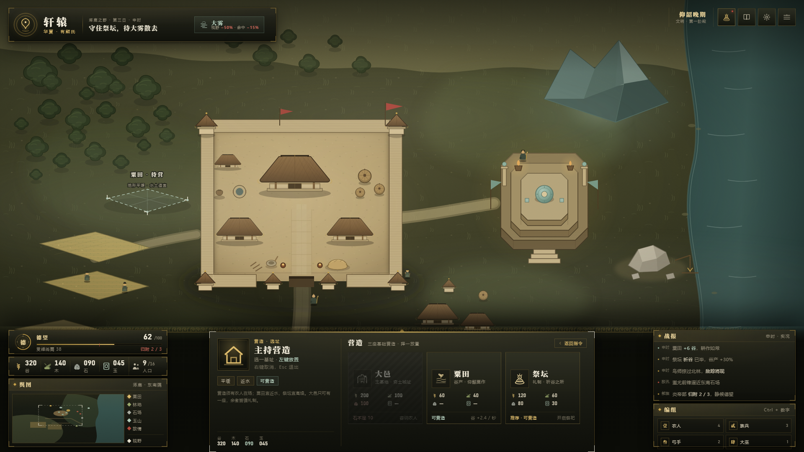
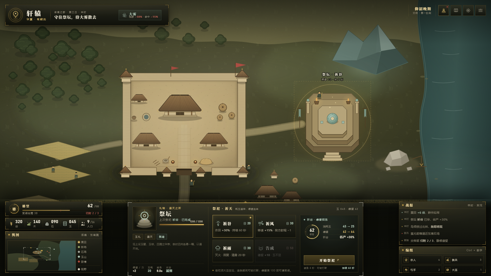
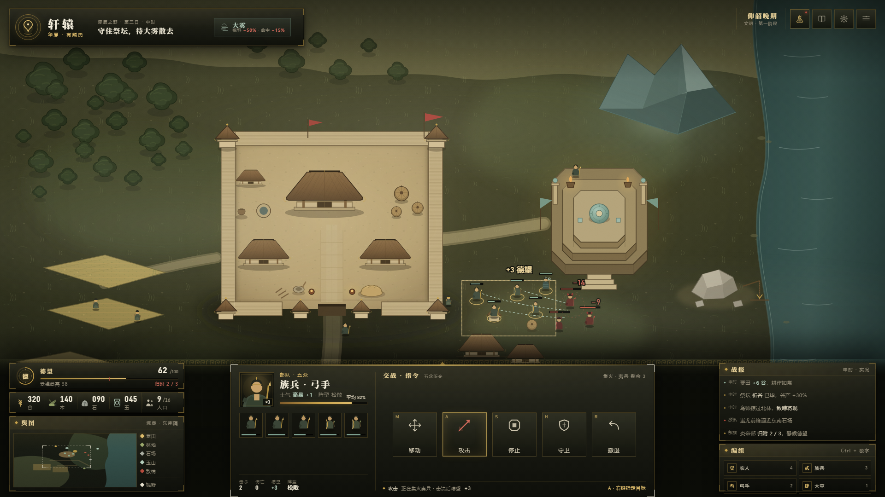
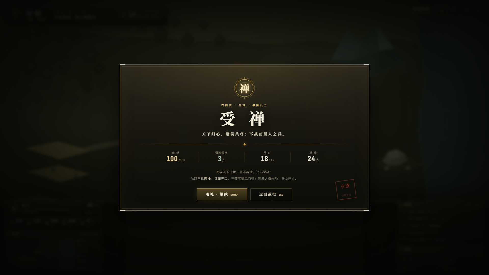
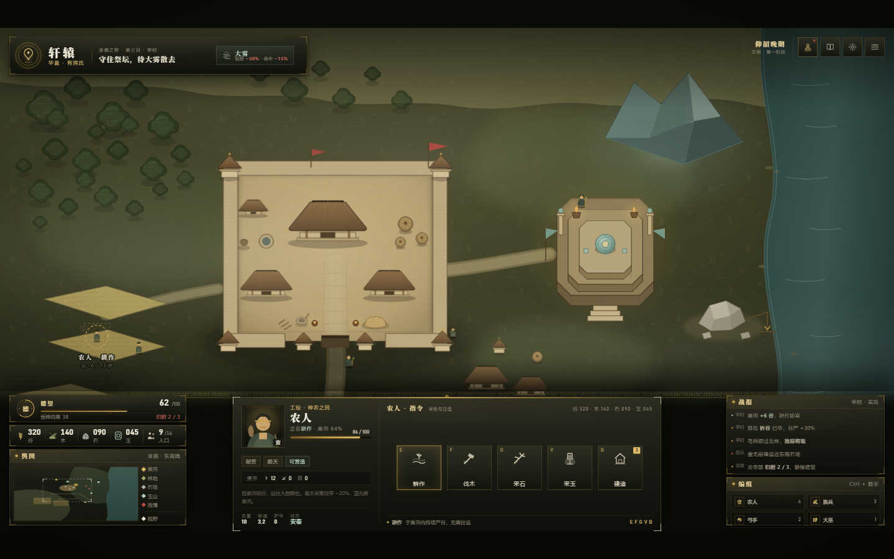

# 轩辕 RTS · UI 方案 A 图廊

中国三皇五帝题材 · 浏览器 2D RTS · 高保真 UI 设计稿（1920×1080 基准）

> 方案 A：经典对称式（星际争霸 II / 帝国时代血统）——底部中央命令台、左下小地图、左下资源与德望。
> 本轮只交付方案 A；B（侧栏式）、C（沉浸窄边框）后续单独安排，复用同一套 token。

- 设计规范：[UI-SPEC.md](UI-SPEC.md)（色板 hex、字号阶梯、间距、组件状态、图标规范）
- 可交互稿：[ui-a.html](ui-a.html) — 下载后双击打开；顶部状态条或数字键 1–6 切换六种状态
- GitHub 不渲染 HTML，请以本页截图为准

---

## 01 空选中 · 干净主界面

看什么：左下「德望」独立面板 + 五连资源带 + 舆图构成左下仪表块；底部命令台在无选中时显示「操典」（四个键位提示），而不是留一片空白；顶部只有身份、任务与大雾天气，不承载操作。

## 02 选中农人 · 五条采集指令

看什么：左侧单位面板的信息密度（头像、称号、状态、气血、特性标签、携带、说明、属性）；中央 5 个 96px 指令按钮垂直居中，右下角是热键；地图上农人带选中环与「耕作中 64%」标签。

## 03 建造菜单 · 三卡与灰态

看什么：大邑 / 粟田 / 祭坛三张建造卡，每张给出谷木石玉造价；「大邑」为不可建造态——斜纹压暗 + 朱砂「石木不足 10」+ 造价不足项转朱砂；地图上「粟田 · 待营」是半透明待落位 ghost，虚线框 + 四角括号。

## 04 选中祭坛 · 祭祀与德望预览

看什么：三层八边形方坛（南阶、玉璧、玉琮、华表、幡）；右侧四张祭祀卡（祈谷 / 祈风 / 祈雨 / 告成），「告成」因玉不足而灰；最右是德望预览环——消耗玉 45→25、德望 62→64、谷产 +30%。

## 05 战斗 · 多选与攻防反馈

看什么：五卒多选（选中框 + 单位卡 + 编队行 + 击杀/伤亡统计）；每个单位头顶血条，友军玉青、敌军朱砂；攻击线、「−14 / −9」伤害飘字与「+3 德望」收益反馈；命令台为移动 / 攻击 / 停止 / 守卫 / 撤退。

## 06 受禅胜利 · 结算浮层

看什么：全屏压暗 + 金线双框卡片；玉璧徽记「禅」、眉标「天命所归 · 德望 100」、宋体大标题「受 禅」、四格数据（德望 / 归附部族 / 在位 / 存民）、朱砂印章与两枚按钮。

## 07 1440 宽适配

看什么：1440×900 下按 `min(w/1920, h/1080)` 等比缩放至 0.75，HUD 不重排、不塌、不换行，上下留 45px 深色边（16:10 屏的正常表现）。

---

## 布局取舍速记

- **命令卡居中**：本作核心是“农人 → 建造 → 祭祀”三段式，命令台需要同时容纳 5 个 96px 指令或 3 张建造卡，只有居中才够宽；同时形成“选中信息（左）→ 指令（中）→ 战报（右）”的阅读顺序。
- **德望升格**：独占 380×58 面板，44px 玉璧徽记 + 金色环轨 + 呼吸光晕，数值 19px（资源 17px），并显示“受禅尚需 38”与 50% 朱砂刻度；绝不与五种资源并排。
- **小地图左下**：与资源同侧，形成“看资源 → 看小地图 → 点小地图”的单侧闭环，且不与命令卡的拇指区争夺右下角。
- **零圆角**：礼器、夯土、木构都是直边，唯一的圆是玉璧与徽记；所有层次靠描金边 + 内受光 + 纸纹噪点堆叠。
